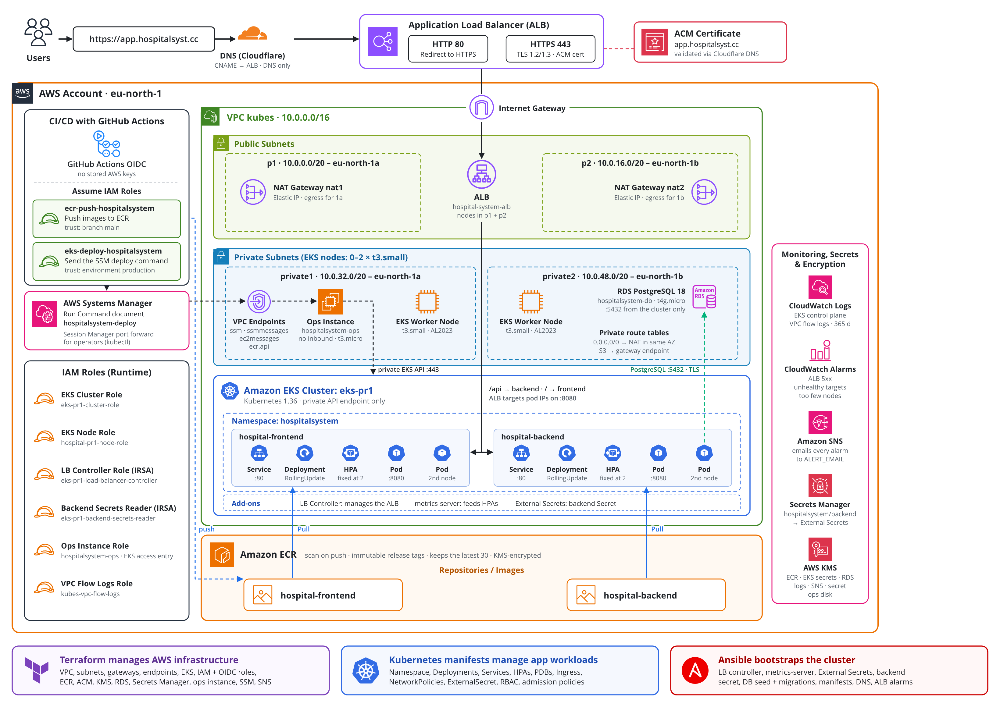

# HospitalSystem Infrastructure

Infrastructure and Kubernetes deployment configuration for:

[KaanMyumyun/HospitalSystem](https://github.com/KaanMyumyun/HospitalSystem)

Current AWS deployment target:

- Public app URL: [https://app.hospitalsyst.cc](https://app.hospitalsyst.cc)
- Runtime platform: Amazon EKS
- Container registry: Amazon ECR
- Ingress: AWS Application Load Balancer
- HTTPS: AWS Certificate Manager
- Database: Amazon RDS for PostgreSQL 18, in the private subnets
- Frontend API base: `/api`

## Highlights

- **One command up, one down.** `./scripts/tf.sh apply` builds the whole stack
  from an empty account, DNS and data included. `./scripts/teardown.sh` saves
  the database into `seed.sql`, destroys everything, and sweeps every region
  for anything still billing.
- **No public Kubernetes API.** The EKS endpoint is private. Operators and
  GitHub Actions reach it through an SSM-managed ops instance that accepts no
  inbound connections.
- **Deploys can only change images.** GitHub Actions gets in through OIDC, and
  admission policies let the deploy group change container images and nothing
  else, only to this account's ECR images.
- **Locked-down workloads.** Restricted Pod Security, read-only root
  filesystems, NetworkPolicies enforced by the VPC CNI, and KMS encryption for
  Secrets, logs, ECR, RDS and Secrets Manager.
- **Tested scripts.** About 160 regression tests run the real shell scripts and
  playbooks against fake `aws`, `kubectl` and `terraform`.
- **Pinned, verified CI.** Actions are pinned to commit SHAs and tool downloads
  are checksum-verified. CI runs Terraform, TFLint, ansible-lint, kubeconform
  and ShellCheck, plus Checkov and Trivy reports.

## Architecture



The application runs on Amazon EKS inside a custom VPC. Public traffic enters
through an AWS Application Load Balancer managed by the AWS Load Balancer
Controller. The ALB terminates HTTPS with ACM and routes:

- `/api` to the backend service
- `/` to the frontend service

Backend and frontend images are built in the application repository and pushed
to Amazon ECR. The backend's PostgreSQL database runs on Amazon RDS in the
private subnets, and only the cluster can reach it.

Every AWS resource, the traffic flow and the database schema are in
[docs/architecture.md](docs/architecture.md).

## How This Was Built

I built the AWS infrastructure by hand first, working through the deployment
flow until the application was serving real traffic on EKS. Once it worked, I
imported the live resources with
[Terracognita](https://github.com/cycloidio/terracognita) and rewrote the
generated output into the Terraform under `terraform/`, split by concern into
network, EKS, IAM, ECR, ACM, and monitoring files. The network and the EKS
cluster later moved into local modules, which replaced the imported
one-resource-per-subnet layout with one per availability zone.

That order was deliberate. Building it in the console first meant I understood
what each resource did and how the pieces connected before codifying any of it,
and the import brought a working environment under version control without
retyping every resource by hand. Turning generated output into readable,
maintainable Terraform was most of the work. The raw Terracognita output was
only a starting point and was never committed.

The Terraform is now the source of truth for the AWS layer; see
[Terraform Workflow](docs/terraform.md#terraform-workflow).

## Quick Start

You need `terraform`, `aws` (logged in), `ansible-playbook`, `kubectl`,
`helm`, a running Docker daemon, `session-manager-plugin` and `python3`. The
first apply builds the images from the application repository, checked out
next to this one as `../HospitalSystem` (`backend_source_dir` changes that).

```bash
cp .env.example .env.local              # fill in the values (see Local setup)
python3 scripts/rotate-jwt-key.py       # writes the JWT key into .env.local
./scripts/tf.sh apply                   # AWS, then the Kubernetes bootstrap
./scripts/monitoring.sh                 # check everything
./scripts/teardown.sh                   # destroy it all when done
```

The database starts empty on every new stack, and the bootstrap loads
`seed.sql` into it. The teardown saves the database back into `seed.sql`
before it destroys anything, so the next stack starts with the data you left.
Before the first apply, put a `pg_dump` of the data to start from in
`seed.sql`, or nobody can sign in (see [Database](docs/disaster-recovery.md#database)).

The stack bills roughly $250 a month while it exists, about $215 of it even
with the nodes paused (see [Costs](docs/operations.md#costs)). After the
apply, confirm the SNS subscription email, or no alarm email arrives.

## Repository Layout

| Folder | What's in it |
| ------ | ------------ |
| `terraform/` | The AWS layer: the root module, `modules/network` and `modules/eks`, and `bootstrap/` for the state bucket |
| `ansible/` | The cluster bootstrap and the playbooks for running the stack |
| `kubernetes/` | Templates of the Kubernetes manifests, rendered by Ansible |
| `scripts/` | `tf.sh`, `teardown.sh`, `monitoring.sh` and the scripts they call |
| `tests/` | Regression tests that run the scripts and playbooks against fake CLIs |
| `config/` | The ALB alarms and the account sweep's ignore list |
| `docs/` | The documentation below |
| `assets/images/` | The diagrams; each `.png` is rendered from its `.svg` |
| `CICD/` | A copy of the application repository's workflows, not run here |

The full tree is in [docs/architecture.md](docs/architecture.md#repository-contents).

## Documentation

| Document | What it covers |
| -------- | -------------- |
| [Architecture](docs/architecture.md) | Every AWS resource, the traffic flow, the database schema, what the manifests and Terraform define, and the full repository tree |
| [Terraform](docs/terraform.md) | The module layout and sizes, local setup, remote state, and what an apply does |
| [CI/CD](docs/cicd.md) | How the application repository tests, builds, scans and deploys a release, with approval, smoke tests and rollback, and releases with migrations |
| [Operations](docs/operations.md) | Cluster access, the backend secret, the playbooks, pausing, database access, costs, rotating the JWT key, and upgrading EKS |
| [Monitoring](docs/monitoring.md) | `monitoring.sh`, the alarms, resource sizing, and which image each app runs |
| [Disaster recovery](docs/disaster-recovery.md) | Rebuilding the stack, what the teardown does, and how the database carries over in `seed.sql` |
| [Checks and tests](docs/testing.md) | What CI checks, and running the checks and regression tests locally |
