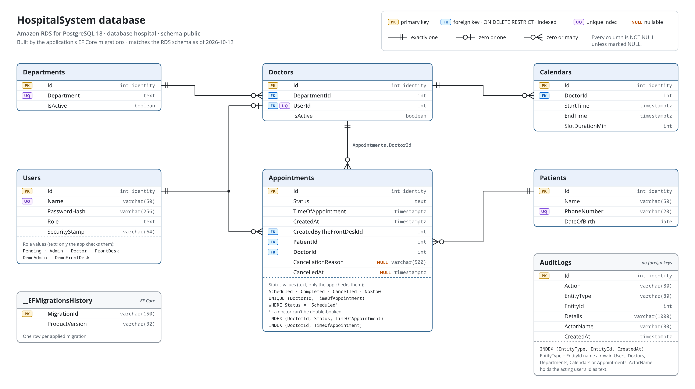

# Architecture

How the stack fits together, in more detail than the
[overview in the README](../README.md#architecture).

## Database schema



The application's EF Core migrations create this schema. This repository only
runs them (see [Database](disaster-recovery.md#database)) and never changes the schema itself.
Every foreign key is `ON DELETE RESTRICT`, so a row that others reference
can't be deleted until those references are gone.

## AWS Resources

Main AWS resources used by this deployment:

| Area | Resources | Purpose |
| ---- | --------- | ------- |
| Network | VPC `kubes` with CIDR `10.0.0.0/16` | Isolated AWS network for the EKS deployment. |
| Public subnets | `p1` `10.0.0.0/20` in `eu-north-1a`, `p2` `10.0.16.0/20` in `eu-north-1b` | Host internet-facing resources such as the ALB and NAT gateways. Tagged for Kubernetes external load balancers. |
| Private subnets | `private1` `10.0.32.0/20` in `eu-north-1a`, `private2` `10.0.48.0/20` in `eu-north-1b` | Host EKS worker nodes and application pods away from direct public internet exposure. Tagged for internal Kubernetes load balancers. |
| Routing | Internet gateway, public route table, private route tables, NAT gateways, Elastic IPs, and VPC endpoints for SSM, S3 and the ECR API | Public subnets route through the internet gateway. Private subnets route outbound traffic through NAT gateways, and S3 traffic through the free gateway endpoint. The ECR API endpoint serves only the deploy's image check from the ops instance. |
| Compute | Amazon EKS cluster `eks-pr1`, managed node group `hospitalsystempr1`, Amazon Linux 2023 worker nodes | Runs the Kubernetes control plane and worker capacity for the app. The node group is sized for low-cost testing and can scale to zero. The Kubernetes API endpoint is private. |
| Cluster access | EC2 instance `hospitalsystem-ops` in a private subnet, SSM document `hospitalsystem-deploy`, EKS access entry | Accepts no inbound connections and has no internet access. Operators reach the private API through an SSM port-forwarding session on it, and GitHub Actions deploys by sending it the SSM document. |
| Database | RDS for PostgreSQL 18 instance `hospitalsystem-db` (`db.t4g.micro`, 20 GB gp2, Single-AZ), its DB subnet group, parameter group and security group | Not public and encrypted with the project's KMS key. Accepts connections on 5432 only from the EKS cluster security group, which the nodes and pods use. Lives as long as the stack. |
| Containers | Amazon ECR repositories for `hospital-backend` and `hospital-frontend` | Stores backend and frontend images built by GitHub Actions. |
| Ingress | AWS Application Load Balancer, HTTP/HTTPS listeners, target groups, and AWS Load Balancer Controller | Exposes the app publicly and maps Kubernetes Ingress rules to AWS load-balancing resources. |
| TLS | AWS Certificate Manager certificate | Provides HTTPS for `app.hospitalsyst.cc` using TLS 1.2/1.3; HTTP traffic redirects to HTTPS. |
| Identity | IAM roles and policies for EKS, worker nodes, AWS Load Balancer Controller, GitHub Actions OIDC, ECR push, and EKS deployment | Allows AWS services, Kubernetes components, and CI/CD workflows to use AWS resources without long-lived access keys. |

Traffic flow:

```text
User
  -> https://app.hospitalsyst.cc
  -> AWS Application Load Balancer in public subnets
  -> Kubernetes Ingress managed by AWS Load Balancer Controller
  -> frontend service for /
  -> backend service for /api
  -> backend connects to RDS PostgreSQL in the private subnets
```

## Repository Contents

```text
terraform/
├── *.tf            # the root module (see Layout and sizing)
├── modules/
│   ├── network/    # VPC, subnets, NAT gateways, VPC endpoints, flow logs
│   └── eks/        # cluster, node group, add-ons and their IAM roles
└── bootstrap/      # the S3 state bucket, created and deleted by the scripts
ansible/
├── group_vars/all/
│   ├── main.yml        # Ansible-owned settings
│   └── terraform.yml   # generated by Terraform, ignored
├── playbooks/
└── tasks/
    ├── kubeconfig.yml  # shared kubeconfig and SSM tunnel setup
    ├── migrate.yml     # the migration Job, used by database.yml and migrate.yml
    └── alb-alarm.yml   # one ALB alarm, used by monitoring.yml
scripts/
├── tf.sh                       # Terraform wrapper: loads .env.local, manages the state bucket
├── teardown.sh                 # full destroy, cleanup and account sweep
├── pre-destroy-cleanup.sh      # deletes the ALB and what the controller made
├── cleanup-orphans.sh          # deletes what a destroy leaves behind
├── account-sweep.py            # lists what is left in every region
├── monitoring.sh               # health checks across AWS, Kubernetes and GitHub
├── rollout-check.sh            # checks a deploy replaces pods without dropping requests
├── image-check.sh              # which image and commit each app runs
├── deploy-release.py           # the deploy the SSM document runs on the ops instance
├── rotate-jwt-key.py           # generates a new JWT key and pushes it
├── push-initial-ecr-images.sh  # run by Terraform on apply
├── apply-workload.py           # used by apply-kubernetes.yml
├── backend-secret.py           # used by backend-secret.yml and apply-kubernetes.yml
├── read-config.py              # used through lib/config.sh
└── lib/                        # shared shell functions
config/
├── alb-alarms.json             # the ALB alarms, read by monitoring.yml and the cleanup
└── account-sweep-ignore.txt    # resources the sweep reports as IGNORED
tests/                  # Python regression tests (see Checks and Tests)
assets/images/          # README diagrams: each .png is rendered from its .svg
CICD/                   # copy of the app repository's workflows, not run here
.github/                # this repository's CI and Dependabot
docs/                   # the documentation the README links to
kubernetes/             # Jinja templates rendered by apply-kubernetes.yml
├── namespace.yaml.j2
├── rbac/
│   └── github-actions-deploy.yaml.j2
├── policy/
│   ├── trusted-workloads.yaml.j2
│   ├── deploy-image-only.yaml.j2
│   └── network.yaml.j2
├── backend/
│   ├── configmap.yaml.j2
│   ├── deployment.yaml.j2
│   ├── external-secret.yaml.j2  # applied by backend-secret.yml
│   ├── migrate-job.yaml.j2      # created by tasks/migrate.yml
│   ├── hpa.yaml.j2
│   ├── pdb.yaml.j2
│   └── service.yaml.j2
├── frontend/
│   ├── deployment.yaml.j2
│   ├── hpa.yaml.j2
│   ├── pdb.yaml.j2
│   └── service.yaml.j2
└── ingress/
    └── ingress.yaml.j2
```

The Kubernetes manifests define:

- `hospitalsystem` namespace, which enforces the restricted Pod Security
  Standard. Both apps run as non-root with a read-only root filesystem
  (emptyDirs for `/tmp` and the backend's `.aspnet` keys), no capabilities,
  the runtime's default seccomp profile and no service account token.
- backend and frontend Deployments and Services, two replicas each, one per
  node, with a PodDisruptionBudget that keeps one available during a drain
- NetworkPolicies that deny all ingress to the namespace except port 8080
  from the ALB's public subnets and from the EKS control plane's network
  interfaces (the deploy's smoke test goes through the API server), plus the
  backend's metrics port 9091 from the control plane only, for
  `scripts/monitoring.sh`'s per-pod metrics read. The vpc-cni add-on
  enforces them; the node's own traffic, such as kubelet probes, is always
  allowed.
- an ExternalSecret that copies the backend secret from AWS Secrets Manager
- a Job that runs the backend image's database migrations, created by the
  bootstrap and by `migrate.yml` (see [Database](disaster-recovery.md#database)), never by a
  deploy
- namespace-scoped RBAC for the deploy group, used by the ops instance's
  deploy document
- an admission policy that only lets the app Deployments run this account's
  backend and frontend ECR images with their own entrypoint, so the deploy
  role can change which release runs but not what code runs
- a second admission policy that lets the deploy group change only container
  images, so a deploy can't add a lifecycle hook, probe, environment variable
  or volume either
- ALB-backed Ingress for `app.hospitalsyst.cc`
- HTTPS listener using ACM, which adds `Strict-Transport-Security` (one
  year), `X-Content-Type-Options: nosniff` and `X-Frame-Options: DENY` to
  every response and drops the ALB's own `Server` header; no
  Content-Security-Policy yet
- `/api` routing to the backend
- `/` routing to the frontend

Terraform manages the AWS infrastructure layer:

- VPC networking, with flow logs to CloudWatch Logs
- subnets and route tables
- NAT and internet gateway resources, and the SSM, S3 and ECR API VPC endpoints
- security groups
- IAM roles and policies, the EKS OIDC provider, and the GitHub Actions OIDC
  provider unless `github_oidc_provider_arn` names an existing one
- EKS cluster, node group, control plane log group, and the ops role's access
  entry
- the vpc-cni, coredns and kube-proxy EKS add-ons, at EKS's default version for
  `eks_version` (a later apply also follows AWS when it changes that default)
- ECR repositories and their lifecycle policies
- the ACM certificate and its Cloudflare validation record
- the project KMS key and the backend's Secrets Manager secret (not its value)
- the RDS PostgreSQL instance, its DB subnet group, parameter group and
  security group (not the data, and not the password, which is write-only)
- the ops instance and the SSM deploy document
- the SNS alert topic and the node group alarm
- running the Ansible bootstrap after apply and the Kubernetes cleanup before
  destroy

The ALB, its listeners, target groups and security groups are not in
Terraform: the AWS Load Balancer Controller creates them from the Ingress.

Kubernetes manages the workload layer:

- `hospitalsystem` namespace
- backend Deployment and Service
- frontend Deployment and Service
- Ingress rules for `/` and `/api`
- RBAC allowing the ops instance's deploy group to change the app
  Deployments' images; GitHub Actions reaches it only through the SSM deploy
  document (see [CI/CD Workflow](cicd.md#cicd-workflow))
- runtime scaling of app replicas
