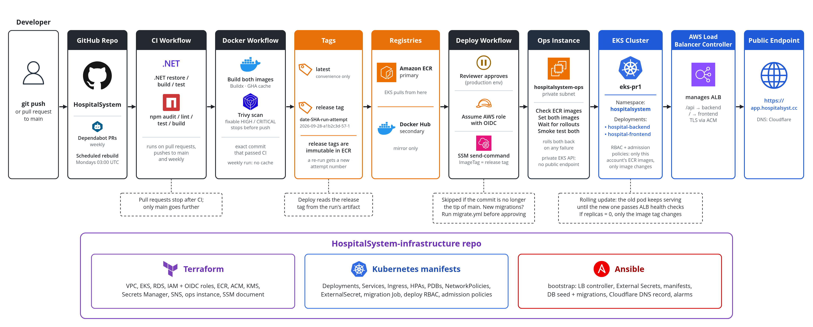

# CI/CD Workflow

Three chained GitHub Actions workflows in the application repository test,
build and deploy every release. Nothing reaches the cluster until the tests
pass, the images pass a Trivy scan and a reviewer approves; a failed rollout or
smoke test puts both apps back on the previous release.



## The pipeline

The workflows live in the `.github/workflows` directory of
[KaanMyumyun/HospitalSystem](https://github.com/KaanMyumyun/HospitalSystem).
`CICD/.github/workflows/` in this repository is a copy kept for review; it
isn't at the repository root, so it never runs here.

| Workflow | Runs | What it does |
| -------- | ---- | ------------ |
| `CI` | On pull requests, pushes to `main`, and weekly on Mondays at 03:00 UTC, so published images pick up base image security fixes | Restores, builds and tests the backend. Audits npm dependencies (fails on `high` or worse), then lints, tests and builds the frontend. |
| `Docker Image CI` | After `CI` succeeds on a push to `main` or on the weekly run | Builds both images from the exact commit that passed CI, scans them, pushes them to Docker Hub and Amazon ECR, and saves the tag and commit as a `release` artifact. |
| `Deploy to EKS` | After `Docker Image CI` succeeds | Waits for approval, then deploys the `release` artifact's tag through the ops instance. See [How a deploy runs](#how-a-deploy-runs). |

Every action is pinned to a commit SHA, and Dependabot keeps the pins current.

### Building the images

- Buildx builds each image once and reuses the build-stage layers from the
  GitHub Actions cache. The runtime stage is always rebuilt, so its
  `apk upgrade` picks up Alpine security fixes; the weekly run skips the cache
  altogether.
- The frontend is built with `VITE_API_URL=/api`: it calls the backend on
  whatever host serves it, so the same image works under any domain.
- Trivy scans both images before anything is pushed. A fixable `HIGH` or
  `CRITICAL` vulnerability stops the run, so every pushed image is a scanned
  one.
- The push to ECR assumes the ECR push role through GitHub Actions OIDC.

### Image tags

| Tag | Example | Why it exists |
| --- | ------- | ------------- |
| `latest` | `hospital-backend:latest` | Convenience tag for manual testing and simple local references. |
| date + short SHA + run number + attempt | `2026-08-21-a1b2c3d-57-1` | The tag deploys use. It's unique to the build, so the weekly rebuild of an unchanged commit gets a new tag instead of overwriting the image Kubernetes runs. Tags from before the attempt was added end at the run number. |

In ECR every tag except `latest` is immutable (`terraform/ecr.tf`). A push that
reuses a tag fails instead of replacing the image, so the tag a deploy checked
and the tag a rollback returns to always name the same image. Re-running a
`Docker Image CI` run keeps its run number but not its attempt, so it pushes
under a new tag instead of failing.

## How a deploy runs

1. `Deploy to EKS` waits for a reviewer to approve it in the `production`
   GitHub environment.
2. It reads the tag and commit from the Docker run's `release` artifact,
   rather than working the tag out again, and skips the deploy if that commit
   is no longer the tip of `main`.
3. It assumes the EKS deploy role through OIDC, finds the running ops instance
   and sends it the `hospitalsystem-deploy` SSM document with the tag.
4. On the instance, the document runs `scripts/deploy-release.py`:
   - It checks that both images exist in ECR, through an ECR API VPC endpoint
     because the instance has no internet access. A missing image fails the
     deploy with both apps untouched.
   - It sets the backend and frontend Deployment images and waits for both
     rollouts.
   - It smoke tests the backend's `/health/ready`, which also checks the
     database, and the frontend's index page, up to three tries each.
5. The workflow fails unless the SSM command succeeded, and prints its output.
   Rollout, smoke test and rollback fit within the document's 600-second
   timeout.

**Rollback.** If a rollout fails or times out, or a smoke request still fails
after three tries, the script puts both Deployments back on the images they
had before and waits for that rollout. Both apps go back even when only one
failed, so they never run different releases. The deploy still fails, and its
output says whether the rollback finished or which images to restore by hand.

**Why through SSM.** The Kubernetes API endpoint is private, so GitHub-hosted
runners can't reach it. A self-hosted runner inside the VPC was ruled out: the
application repository is public, so pull requests from forks could run
workflows on it.

**Limits of the smoke test.** The smoke requests go through the Kubernetes API
server's Service proxy, not the ALB, so they don't test the Ingress, the ALB or
DNS.

**A scaled-down app.** If the app is scaled to `0`, the deploy still sets the
new image tag on both Deployments but doesn't wait for a rollout, since no pods
are running. The next scale-up starts pods from that tag.

### Rollouts without downtime

- Both Deployments use `RollingUpdate` with `maxSurge: 1` and
  `maxUnavailable: 0`: a new pod starts next to the old one, and the old pod
  goes only once the new one is available.
- The namespace has the `elbv2.k8s.aws/pod-readiness-gate-inject: enabled`
  label, so the AWS Load Balancer Controller holds a new pod's readiness until
  its ALB target passes health checks.
- A terminating pod waits 15 seconds in a `preStop` hook while the ALB
  deregisters it, and the target groups drain for 30 seconds.
- A new pod that never becomes healthy leaves the old pod serving. The
  Deployment is marked failed after `progressDeadlineSeconds: 300`, and the
  deploy rolls both apps back.

The backend's health checks are split so a database restart can't take the
whole backend down:

| Check | Endpoint | Checks the database |
| ----- | -------- | ------------------- |
| Startup probe, until it first passes (about two minutes allowed) | `/health/ready` | Yes |
| Readiness, liveness and the ALB, from then on | `/health` | No |

So every new pod reaches the database before its rollout completes, but a later
database restart, such as RDS installing a minor version, doesn't make running
pods unready or restart them all at once. `./scripts/monitoring.sh app` checks
the database on demand.

## Who can deploy what

| Identity | What it can do |
| -------- | -------------- |
| GitHub Actions deploy role | Send the `hospitalsystem-deploy` document to the ops instance, and nothing in Kubernetes. The document's only input is the image tag: it builds the image URLs from the ECR repositories itself. |
| Ops instance role | Join the `hospitalsystem:deployers` Kubernetes group, through a Terraform-managed EKS access entry. |
| `hospitalsystem:deployers` | Read and patch only the `hospital-backend` and `hospital-frontend` Deployments, and send GET requests to the two app Services for the smoke test (`kubernetes/rbac/github-actions-deploy.yaml.j2`). |

Two admission policies back this up.
`kubernetes/policy/deploy-image-only.yaml.j2` rejects any change by the group
other than container images, and `kubernetes/policy/trusted-workloads.yaml.j2`
lets every Deployment in the namespace run only this account's backend and
frontend ECR images, with their own entrypoint.

### OIDC trust

The GitHub Actions roles trust only `KaanMyumyun/HospitalSystem`, each with one
OIDC subject:

- **ECR push role:** workflows running on `main` (`github_deploy_branch` in
  Terraform). Docker Image CI qualifies because `workflow_run` jobs run on the
  default branch. Protect `main` in GitHub: require pull requests, and block
  force pushes and deletion.
- **EKS deploy role:** jobs that use the `production` environment
  (`github_deploy_environment`). Their token's subject is the environment, not
  the branch, so GitHub has to enforce the branch: in Settings, Environments,
  `production`, set Deployment branches to `main` only and add required
  reviewers, so every deploy waits for approval.

An AWS account can hold only one `token.actions.githubusercontent.com` OIDC
provider. Terraform creates it unless `github_oidc_provider_arn` is set; set
that to the existing provider's ARN when another project in the account
already has one.

### Repository variables

The deploy workflow reads the SSM document and ops instance name from the
`DEPLOY_SSM_DOCUMENT` and `DEPLOY_INSTANCE_NAME` repository variables, which are
the `deploy_ssm_document_name` and `ops_instance_name` Terraform outputs. The
application README lists every variable the workflows need.

### The aws-auth ConfigMap

The cluster keeps `API_AND_CONFIG_MAP` authentication, so existing node and
other `aws-auth` mappings stay valid. Bootstrap no longer creates or patches
that ConfigMap. Leave it and its node mappings in place: existing managed node
groups can still depend on them, while EKS manages access for new ones. See the
AWS guidance on
[migrating access entries](https://docs.aws.amazon.com/eks/latest/userguide/migrating-access-entries.html)
and [managed node group access](https://docs.aws.amazon.com/eks/latest/userguide/creating-access-entries.html).

## Releases with migrations

A deploy only changes images; it never touches the database schema. The deploy
group can't create Jobs or read the backend Secret, and the database accepts
connections only from inside the cluster. When a release adds an EF Core
migration, apply it before approving that release's `Deploy to EKS` run:

```bash
ansible-playbook ansible/playbooks/migrate.yml -e image_tag=2026-08-22-8f88481-57-1
```

The playbook checks that the tag is in ECR, runs the image's `--migrate`
command as a Job in the cluster (`kubernetes/backend/migrate-job.yaml.j2`) with
only the connection string from the backend Secret, then prints the Job's log
and deletes it. A release without new migrations changes nothing.

Migrations only go forward, and the running release keeps serving while they
apply, so each one has to work with both the running image and the new one.
The application README describes how to write them that way.
